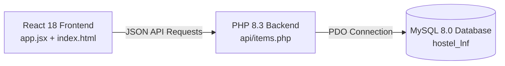

# Hostel Lost & Found Portal

A full-stack campus notice board built with **React 18**, **PHP 8.3 REST API**, and **MySQL 8.0**.

---

## Architecture Overview



1. **Frontend (React 18)**:
   - Dynamic, reactive UI in [`app.jsx`](file:///d:/My%20Projects/web_programmin/lnfx/app.jsx).
   - Real-time search by keyword, item name, location, or code.
   - Dynamic filtering by Status (*Lost, Found, Claimed*) and Category (*Electronics, ID & Documents, Clothing, etc.*).
   - Instant form submission posting directly to the PHP MySQL backend.
   - Live database health badge in the navigation bar.
   - 1-click "Claim / Reopen" notice status toggling.
   - Contact modal with copyable details and delete notice support.

2. **Backend API (PHP 8.3)**:
   - Modular REST API inside the [`api/`](file:///d:/My%20Projects/web_programmin/lnfx/api/) folder:
     - [`api/db.php`](file:///d:/My%20Projects/web_programmin/lnfx/api/db.php): Centralized PDO connection with auto-initialization (automatically creates `hostel_lnf` database and `items` table if missing, and seeds initial records).
     - [`api/items.php`](file:///d:/My%20Projects/web_programmin/lnfx/api/items.php): Handles `GET` (search & filter), `POST` (create notice), `PUT` (mark claimed/reopen), and `DELETE` (remove notice).
     - [`api/stats.php`](file:///d:/My%20Projects/web_programmin/lnfx/api/stats.php): Returns live database counts.
     - [`api/reset.php`](file:///d:/My%20Projects/web_programmin/lnfx/api/reset.php): Reseeds default sample notices into MySQL.
     - [`api/test_db.php`](file:///d:/My%20Projects/web_programmin/lnfx/api/test_db.php): Health check endpoint for connection verification.

3. **Database (MySQL 8.0)**:
   - Database name: `hostel_lnf`
   - Table: `items`
     - `id`: Auto-increment primary key
     - `item_code`: Unique notice identifier (e.g., `L-0128`, `F-0127`)
     - `type`: `lost` or `found`
     - `name`: Item title
     - `category`: Category name
     - `location`: Location where lost/found
     - `item_date`: Date reported
     - `description`: Identifying details
     - `contact`: Room number, phone, or email
     - `status`: `open` or `claimed`
     - `created_at`: Timestamp

---

## How to Run

### Method 1: One-Click Launcher (Recommended)
Simply double-click [`start-server.bat`](file:///d:/My%20Projects/web_programmin/lnfx/start-server.bat). It will:
1. Start the PHP built-in web server at `http://localhost:8000`.
2. Automatically launch your default web browser to the portal.

### Method 2: Command Line
Open a terminal in this project folder and run:
```bash
php -S localhost:8000
```
Then navigate to: **`http://localhost:8000`**

### Database Configuration
By default, the application connects to MySQL on `127.0.0.1:3306` with user `root`.
To customize credentials without modifying tracked files:
- Copy `api/config.example.php` to `api/config.local.php` and set your MySQL password.
- Or set environment variables (`DB_HOST`, `DB_PORT`, `DB_USER`, `DB_PASS`, `DB_NAME`).

---

## File Structure

```
d:/My Projects/web_programmin/lnfx/
├── index.html            # Main HTML shell mounting React
├── app.jsx               # React 18 application component
├── style.css             # Clean, responsive CSS styling
├── start-server.bat      # 1-click server runner
├── README.md             # Documentation
└── api/                  # PHP Backend Endpoints
    ├── db.php            # MySQL PDO connection & auto-table creator
    ├── config.example.php# Configuration template for local credentials
    ├── items.php         # REST API for notices (GET, POST, PUT, DELETE)
    ├── stats.php         # Live counts for stats counter
    ├── reset.php         # Reseed sample data in MySQL
    └── test_db.php       # MySQL connection test
```
